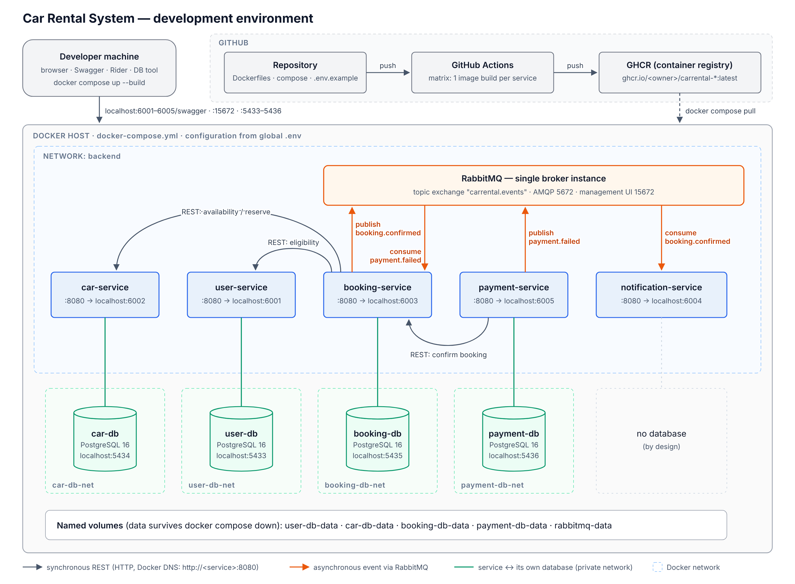

# Car Rental System — Development of Large Systems

Microservices solution for the semester project.

## Development environment (Docker)



Everything runs from one `docker-compose.yml` in the repo root:

| Container | Image | Host port(s) | Networks |
|---|---|---|---|
| `user-service` | built from `CarRental.UserService/Dockerfile` | 6001 | backend, user-db-net |
| `car-service` | built from `CarRental.CarService/Dockerfile` | 6002 | backend, car-db-net |
| `booking-service` | built from `CarRental.BookingService/Dockerfile` | 6003 | backend, booking-db-net |
| `notification-service` | built from `CarRental.NotificationService/Dockerfile` | 6004 | backend |
| `payment-service` | built from `CarRental.PaymentService/Dockerfile` | 6005 | backend, payment-db-net |
| `user-db`, `car-db`, `booking-db`, `payment-db` | `postgres:16-alpine` (one server each) | 5433–5436 | its own `*-db-net` only |
| `rabbitmq` | `rabbitmq:3.13-management-alpine` (single instance) | 5672, 15672 | backend |

```bash
cp .env.example .env          # global env file (git-ignored) — edit if ports clash
docker compose up --build     # build all images and start everything
```

- Swagger: `http://localhost:6001/swagger` … `http://localhost:6005/swagger`
- Health: `http://localhost:600X/health`
- RabbitMQ UI: `http://localhost:15672` (user/password from `.env`)
- Databases from Rider/DBeaver: `localhost:5433`–`5436` (credentials in `.env`)
- Stop: `docker compose down` · wipe all data too: `docker compose down -v`

**Design notes**

- **Multi-stage Dockerfiles.** Stage 1 (`dotnet/sdk:8.0`) packs `CarRental.Shared` into
  `local-nuget-feed/` exactly like the manual build order below, restores the service
  and publishes it. Stage 2 (`dotnet/aspnet:8.0`) only contains the published output and
  runs as the non-root `app` user. `.csproj` files are copied before the source so the
  `restore` layer stays cached. The build context is the repo root (the service needs
  `nuget.config` and `CarRental.Shared`), so build a single image with
  `docker build -f CarRental.BookingService/Dockerfile .`
- **Database per service.** Each database is its own PostgreSQL container on a private
  network that only its owner joins — e.g. Booking Service physically cannot reach
  `user-db`. Data lives in named volumes.
- **Configuration.** One global `.env` (template: `.env.example`) feeds compose. The
  services read it through standard ASP.NET Core env-var overrides
  (`Services__CarService`, `RabbitMq__Host`, `ConnectionStrings__DefaultConnection`, …),
  so `appsettings.json` keeps working for local IDE runs.
- **Service discovery** uses Docker DNS: services call each other at
  `http://<service-name>:8080`. Inside containers only HTTP is used (no certificates), so
  `UseHttpsRedirection` is skipped when `DOTNET_RUNNING_IN_CONTAINER` is set.
- **Startup order.** Services wait for their database and RabbitMQ healthchecks
  (`depends_on: condition: service_healthy`); the RabbitMQ client also retries the
  connection on start.

## CI/CD — images to GitHub Container Registry

`.github/workflows/docker-images.yml` validates the compose file and then builds the
five images in parallel (matrix). On pull requests the images are only built; on push
to `main` they are pushed as `ghcr.io/<owner>/carrental-<service>` with the tags
`latest` and `sha-<commit>` (plus `1.2.3` for a `v1.2.3` git tag). It uses the built-in
`GITHUB_TOKEN`, so no secrets need to be set up.

To run the CI-built images instead of building locally, set `IMAGE_NAMESPACE` in `.env`
to the lowercase GitHub owner and run `docker compose pull && docker compose up`.
New GHCR packages are private by default: either `docker login ghcr.io` with a personal
access token (`read:packages`), or make each package public under the repository's
*Packages* settings.

## Solution files — one per service, on purpose

Each microservice has **its own `.sln` file** inside its own folder (e.g.
`CarRental.BookingService/CarRental.BookingService.sln`), referencing only
itself. `CarRentalSystem.sln` in the repo root still exists and references
all 6 projects, for running/testing the whole system together.

**Why:** a `.sln` file is a plain text file listing project GUIDs. If everyone
on the team opens and edits the one shared root solution, unrelated changes
can touch that same file and cause git merge conflicts — even when nobody
touched each other's actual code. With a separate `.sln` per service, whoever
is working on Booking Service opens `CarRental.BookingService.sln` and never
touches the file someone else working on Car Service is using.

**Day-to-day workflow:** open your own service's `.sln` (e.g.
`CarRental.BookingService.sln`) to work on that service. Open the root
`CarRentalSystem.sln` only when you need to run several services together.

## CarRental.Shared is a NuGet package, not a project reference

The 5 services depend on `CarRental.Shared` (enums/DTOs/events) via
`<PackageReference Include="CarRental.Shared" Version="1.0.0" />` in their
`.csproj`, **not** `<ProjectReference>`. `CarRental.Shared.csproj` is set to
build itself into a `.nupkg` on every build (`GeneratePackageOnBuild`) and
drop it into `local-nuget-feed/` at the repo root; `nuget.config` at the repo
root registers that folder as a package source so the other services can
restore it without needing an external NuGet server.

**Why:** a plain `ProjectReference` means every service's build depends on
whatever Shared's source code looks like *right now* — a change to Shared by
one teammate can silently break another service's build the moment they pull.
A versioned package means each service depends on a specific, deliberate
release of Shared (e.g. `1.0.0`), which is what "each microservice must be
independently deployable" actually requires.

**⚠️ Required build order — read this before building anything:**
1. Build `CarRental.Shared` first (open its `.sln`... it doesn't have one on
   its own since nothing runs it directly — just build it from the root
   `CarRentalSystem.sln`, or `dotnet build CarRental.Shared`). This creates
   `local-nuget-feed/CarRental.Shared.1.0.0.nupkg`.
2. *Only after that* can the 5 services restore/build, since their
   `PackageReference` needs that `.nupkg` to already exist.
3. Whenever you change something in `CarRental.Shared`, bump `<Version>` in
   `CarRental.Shared.csproj`, rebuild it, then bump the `<PackageReference>`
   version in whichever service(s) should pick up the change and rebuild them.

`local-nuget-feed/` is git-ignored (it's a build output, not source) — every
teammate generates their own copy locally by building `CarRental.Shared`
after cloning.

## Projects and ports

Ports below are for running from the IDE (`launchSettings.json`); in Docker every
service listens on 8080 inside the container and is published on 6001–6005.

| Project | Port (HTTPS) | Own database |
|---|---|---|
| CarRental.UserService | 5001 | Yes (PostgreSQL container ready; EF Core later) |
| CarRental.CarService | 5002 | Yes (PostgreSQL container ready; EF Core later) |
| CarRental.BookingService | 5003 | Yes (PostgreSQL container ready; EF Core later) |
| CarRental.NotificationService | 5004 | No — by design |
| CarRental.PaymentService | 5005 | Yes (PostgreSQL container ready; EF Core later) |
| CarRental.Shared | — (NuGet package, not a runnable service) | — |

Each service is its own ASP.NET Core Web API project so they can run and be deployed independently. Swagger is enabled in Development at `/swagger` on each service's port.

## Current storage

All services use in-memory storage (`ConcurrentDictionary`/`List` behind the interfaces) for now, so the whole solution runs without a database. When the database is added, only the class implementing e.g. `IBookingService` needs to change to use an injected EF Core `DbContext` — controllers and interfaces stay the same.

## Cross-service communication

**Synchronous (REST over HTTP)** — the caller needs an answer right away:

- Booking Service → Car Service: check/reserve/release availability
- Booking Service → User Service: eligibility check (age 21+, valid licence)
- Payment Service → Booking Service: confirm booking

**Asynchronous (RabbitMQ events)** — fire-and-forget, so a slow or failing
receiver can never block a booking. All events go to the topic exchange
`carrental.events`; each consumer owns its own durable queue.

| Event | Routing key | Publisher | Consumer (queue) |
|---|---|---|---|
| `BookingConfirmedEvent` | `booking.confirmed` | Booking (`Messaging/RabbitMqEventPublisher`) | Notification (`notification-service.booking-confirmed`, `Consumers/BookingConfirmedConsumer`) |
| `PaymentFailedEvent` | `payment.failed` | Payment (`Messaging/RabbitMqPaymentEventPublisher`) | Booking (`booking-service.payment-failed`, `Messaging/PaymentFailedConsumer`) |

Messaging is switched on with `RabbitMq:Enabled=true` (docker-compose sets it).
With the default `false` from `appsettings.json` the services fall back to the
old REST calls (`HttpEventPublisher`, `PaymentEventsController`,
`NotificationController`), so a single service can still be run from the IDE
without a broker.

## Requirement → code map

- Age 21+ / valid licence → `Customer.IsEligibleToRent` (UserService), checked via `IUserServiceClient` before booking
- Real-time availability / no double booking → `CarService.TryReserveAsync` (atomic per-car lock; becomes an EF Core concurrency token later)
- First-completed-reservation-wins → same atomic reservation in `CarService`
- Duplicate booking check → `BookingService.HasOverlappingBookingAsync`
- Price per day by car type → `Booking.TotalPrice`, `Car.PricePerDay`
- Free cancellation ≥48h / 25% fee <48h → `Booking.IsWithinFreeCancellationWindow`, `BookingService.CancelBookingAsync`
- No cancellation after pickup → `Booking.CanBeCancelled`
- Payment failure cancels reservation → `PaymentService.ProcessPaymentAsync` → `IBookingServiceClient.NotifyPaymentFailedAsync` → `BookingService.HandlePaymentFailedAsync`
- Notification retries, never blocks booking → `NotificationService.SendWithRetryAsync`
- AI recommendation by passengers/price → `CarService.GetAiRecommendationsAsync` (rule-based placeholder — swap for a real model call later)

## Next steps

1. Add EF Core + Npgsql per service (Code-First from the existing model classes) — the
   PostgreSQL containers and `ConnectionStrings__DefaultConnection` are already in place
2. Add authentication (JWT) to `AuthController`
4. Add a frontend project talking to these APIs over REST/GraphQL
